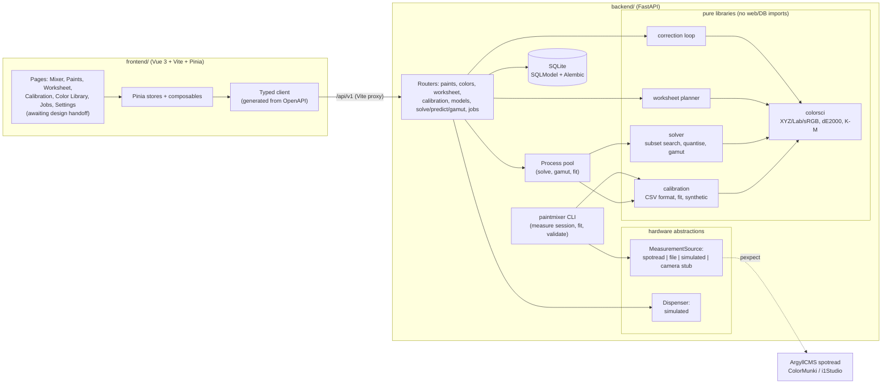

# PaintMixer

PaintMixer takes a library of physical paints and a target colour (picked from a colour library,
or given as hex/sRGB/Lab or a measured spectrum) and computes mixing recipes that reproduce it.
Paints are modelled with two-constant **Kubelka-Munk** theory. Each paint's absorption K(λ) and
scattering S(λ) is fitted from spectrophotometer drawdowns (X-Rite ColorMunki / i1Studio driven
by ArgyllCMS). The solver searches subsets of the paints for the best match, quantises the recipe
to the dispenser's resolution, and reports colour error (dE2000), cost (SGD), metamerism and dose
sensitivity. Hardware (instrument, dispenser) sits behind interfaces with simulators, so the whole
pipeline runs without any devices.

> **Status:** backend milestones M0–M5 and M7–M9 are done. The frontend has its typed API client,
> Pinia stores and composables (with Vitest tests), but the **UI pages (M6) are waiting for the
> Claude Design handoff bundle** in `design/handoff/`. The Playwright smoke test is part of M6.
> In the meantime every workflow works through the REST API (interactive docs at `/api/v1/docs`)
> and the CLI.

## Architecture



## Setup (macOS)

```bash
brew install uv node argyll-cms
```

```bash
make install
```

```bash
make dev
```

`make dev` runs FastAPI on :8000 (it applies migrations first) and Vite on :5173, which proxies
`/api` to FastAPI. The API docs are at <http://localhost:8000/api/v1/docs>. Data is stored in
`backend/var/paintmixer.db`; set `PAINTMIXER_DATA_DIR` or `PAINTMIXER_DATABASE_URL` to change that.

| Command | What it does |
|---|---|
| `make test` | backend unit + API tests (excluding slow ones) and Vitest |
| `make test-slow` | solver accuracy/performance suites: staged vs exhaustive on 200 targets, 12/20-paint timing (~3 min) |
| `make lint` | ruff, ruff format --check, mypy --strict, vue-tsc |
| `make gen-api` | export `backend/openapi.json` and regenerate `frontend/src/api/schema.d.ts` |
| `make sample-data` | regenerate the synthetic files in `sample_data/` |

Environment variables: `PAINTMIXER_CURRENCY` (default SGD), `PAINTMIXER_COMPUTE_WORKERS`
(solver/fit worker processes, default 2; 0 = thread pool), `PAINTMIXER_SEED`.

## Walkthrough with the sample data

`sample_data/` holds 9 synthetic paints (the 5-paint starter set W, K, C, M, Y is "loaded" on
channels 1–5), a colour library, and calibration files produced by the synthetic generator from
known K/S (`synthetic_truth_*.json`). With `make dev-backend` running:

```bash
API=http://localhost:8000/api/v1
```

1. Import the paints and the colour library:

```bash
curl -s -F file=@sample_data/paints.csv $API/paints/import
```

```bash
curl -s -F file=@sample_data/color_library.csv $API/colors/import
```

2. Generate a calibration worksheet for the starter set: 63 drawdowns, 124 rows, 12 hold-outs,
   per-paint totals and a low-mass warning for the 1 % black tint. Add `/csv` for the CSV skeleton
   or `/html` for a printable sheet.

```bash
curl -s -X POST $API/worksheet -H 'content-type: application/json' -d '{"paint_ids":["titanium-white","carbon-black","phthalo-blue","quinacridone-magenta","arylide-yellow"]}'
```

3. Upload the measured calibration. Here that's the synthetic file standing in for a measure
   session; the validator reports any problem by line and column.

```bash
curl -s -F file=@sample_data/calibration_starter5.csv $API/calibration/upload
```

4. Fit K/S in the background, then poll the run and read the hold-out report:

```bash
curl -s -X POST $API/calibration/fit -H 'content-type: application/json' -d '{}'
```

```bash
curl -s $API/calibration/fits/1
```

```bash
curl -s $API/models/1
```

   On this data the fit takes about 0.6 s and the hold-out mean dE2000 is ~0.9. That is the same
   as the measurement-noise floor the report prints (σ = 0.002 reflectance noise is ~0.9 dE on
   dark drawdowns). Against the noise-free ground truth the model is within ~0.25 dE2000.

5. Solve for a target:

```bash
curl -s -X POST $API/solve -H 'content-type: application/json' -d '{"target":{"hex":"#7a9e9f"},"top_n":3}'
```

   The best recipe is white 95.7 ml + phthalo blue 2.1 + carbon black 1.6 + arylide yellow 0.4 ml
   (dE2000 0.18 after quantising to 0.05 ml, SGD 6.10 per 100 ml), followed by ranked
   alternatives. Each comes with the predicted spectrum, metamerism under A/F11, dose sensitivity
   and warnings.

6. Create a job from a candidate, then dispense, measure and correct with the simulators until
   it's within tolerance (status `done`):

```bash
curl -s -X POST $API/jobs -H 'content-type: application/json' -d '{"target":{"hex":"#7a9e9f"},"components":{"titanium-white":0.957,"phthalo-blue":0.021,"carbon-black":0.016,"arylide-yellow":0.004}}'
```

```bash
curl -s -X POST $API/jobs/1/dispense -H 'content-type: application/json' -d '{}'
```

```bash
curl -s -X POST $API/jobs/1/measurement -H 'content-type: application/json' -d '{"simulate":true,"simulate_gain":1.05}'
```

```bash
curl -s -X POST $API/jobs/1/correct -H 'content-type: application/json' -d '{}'
```

   Repeat dispense → measurement → correct while the status is `correcting`. With a 5 % simulated
   model bias, the first mix is ~1.0 dE off and one correction (added to the cup) brings it to ~0.3.

The same calibration can be fitted offline:

```bash
cd backend && uv run paintmixer fit ../sample_data/calibration_pool9.csv --paints ../sample_data/paints.csv
```

## Measuring real paints

See [docs/measurement.md](docs/measurement.md) for the instrument setup on macOS and the
resumable `paintmixer measure session` (3 readings per background, spread stored, repeatability
warnings). Calibration file format: [docs/calibration_format.md](docs/calibration_format.md),
with a [JSON Schema](docs/calibration_row.schema.json).

**Expected accuracy.** On synthetic data the fitted model reproduces held-out mixtures to < 0.5
dE2000. With real paints, two-constant K-M alone typically gives **1–3 dE2000**: pigment
interactions, surface effects and film-thickness variation are not modelled. The closed-loop
correction exists to close that gap. Fluorescent and metallic paints are out of scope (45/0
geometry, UV-cut).

## How it works (short)

* **Colour maths** (`colorsci`): 31 bands 400–700 nm; ASTM E2022 weights (D65, D50, A, F11, CIE
  1931 2°); dE2000 verified on all 34 Sharma pairs and against colour-science.
* **Model:** `k = Σc·K / Σc·S`, `R∞ = 1 + k − √(k² + 2k)`, Saunderson correction (k1, k2
  configurable). Drawdowns use the finite-thickness form over the measured black/white substrate.
* **Fit:** regularised nonlinear least squares on log K, log S and a per-band optical-thickness
  scale. `S_white = 1` fixes K-M's scale ambiguity. Validation uses flagged hold-outs or k-fold.
* **Solver:** every subset up to 5 paints is screened at once with a batched
  Levenberg–Marquardt (pools of 14 or fewer; larger pools use greedy-beam + swap search). The best
  are refined with SLSQP on dE2000 + paint count + cost + metamerism, then quantised to dispenser
  steps. Measured times: 12 paints ~0.7 s, 20 paints ~0.8 s.
* **Why 5 paints:** colour has 3 degrees of freedom, but white (the only source of scattering, for
  pale colours) and black (for darks and clean neutrals) are separate physical needs. W, K + 3
  chromatics is the minimum full-range set.

Design decisions and judgement calls are recorded in [PLAN.md](PLAN.md) and
[docs/ASSUMPTIONS.md](docs/ASSUMPTIONS.md); contributor notes are in [CLAUDE.md](CLAUDE.md).

Not used: Mixbox (non-commercial licence).
